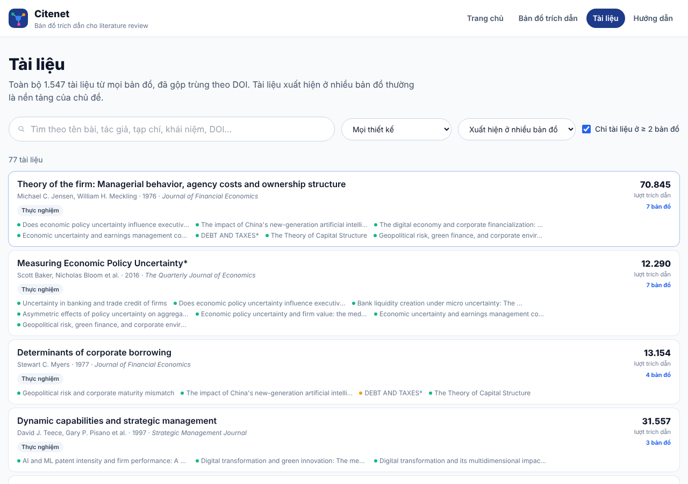

# Citenet Web: bản đồ trích dẫn cho literature review

Web tĩnh để **xem, lọc và tải** các bản đồ trích dẫn do công cụ **Citenet** tạo ra. Mỗi bản đồ xuất phát từ một DOI: bài đó trích dẫn ai (backward), ai trích dẫn lại nó (forward) và những bài liên quan.

🔗 **Xem web:** https://xuandieu68.github.io/-citenet_web/


> Citenet dùng để **khởi động** literature review và khám phá tài liệu. Công cụ không thay thế systematic review, việc đọc toàn văn hay kiểm tra thủ công. Nhãn phân loại chỉ là gợi ý sắp xếp, không phải kết luận khoa học.

## Tính năng

| Trang | Địa chỉ | Nội dung |
|---|---|---|
| Trang chủ | `#/` | Giới thiệu, ô tìm kiếm, số liệu tổng, bản đồ mới cập nhật, tài liệu nền tảng, cách Citenet hoạt động |
| Bản đồ trích dẫn | `#/maps` | 24 bản đồ; tìm theo tên bài, tác giả, tạp chí, DOI; lọc lĩnh vực; sắp xếp |
| Chi tiết bản đồ | `#/map/<slug>` | Thông tin bài gốc, số liệu lần chạy, **biểu đồ tương tác**, bảng chi tiết tài liệu, tải CSV / RIS / BibTeX / báo cáo, danh sách tài liệu có bộ lọc |
| Tài liệu | `#/papers` | 1.547 tài liệu của mọi bản đồ, đã gộp trùng theo DOI. Lọc "xuất hiện ở ≥ 2 bản đồ" để tìm bài nền tảng |
| Hướng dẫn | `#/guide` | Cách đọc biểu đồ và các con số, file tải về, giới hạn, cách thêm bản đồ mới |

**Biểu đồ trích dẫn** giữ đúng bố cục và màu của `graph.html` trong Citenet:
- Màu theo nhóm: 🔵 bài gốc, 🟢 tài liệu tham khảo, 🟠 bài trích dẫn, 🩷 bài liên quan.
- Kích thước nút theo số lượt trích dẫn. Viền nét đứt màu vàng là tài liệu cần kiểm tra.
- Kéo để di chuyển, cuộn hoặc bấm +/− để phóng to, bấm chú thích để ẩn/hiện từng nhóm.
- Rê chuột vào nút để xem tooltip, bấm vào nút để mở bảng chi tiết.
- Ô lọc bên dưới biểu đồ làm mờ những nút không khớp, nên biểu đồ và danh sách luôn đi cùng nhau.


**Thẻ xem nhanh khi rê chuột**, tái sử dụng qua component `HoverPreview`:
- Thẻ bản đồ (lưới): thẻ rộng gấp đôi đè lên, gồm tóm tắt bài gốc, số tài liệu từng nhóm và tài liệu được trích dẫn nhiều nhất. Thẻ tự mở sang trái nếu sát mép phải.
- Dòng tài liệu (danh sách): thẻ hiện ngay bên dưới, canh phải, nên không che dòng gốc. Gồm tác giả, tóm tắt, khái niệm và link DOI.
- Chỉ hoạt động với chuột. Trên điện thoại, chạm là mở thẳng.

| Bản đồ | Danh sách tài liệu | Tài liệu nền tảng |
|---|---|---|
|  |  |  |

## Công nghệ

React 18 · Vite 5 · Tailwind CSS 3 · React Router 6 (`HashRouter`) · SVG thuần (không cần thư viện biểu đồ) · Python 3 cho bước chuẩn bị dữ liệu · GitHub Actions + GitHub Pages.

Web không có máy chủ và không gọi API. Toàn bộ dữ liệu là file JSON tĩnh sinh ra từ kết quả Citenet.

## Cấu trúc thư mục

```
citenet-web/
├─ .github/workflows/deploy.yml     # Build + deploy lên GitHub Pages khi push lên main
├─ scripts/build_data.py            # ★ outputs/Citenet → public/data + public/downloads
├─ public/
│  ├─ data/index.json               # Danh sách bản đồ + số liệu tổng
│  ├─ data/papers.json              # Tài liệu đã gộp trùng + các bản đồ chứa nó
│  ├─ data/maps/<slug>.json         # Nút, cạnh, số liệu của từng bản đồ
│  └─ downloads/<slug>/             # refs.csv, refs.ris, refs.bib, summary.md
├─ docs/images/                     # Ảnh cho README
├─ vite.config.js                   # ★ base: '/<tên-repo>/'
└─ src/
   ├─ App.jsx                       # Header, footer, định tuyến 5 trang
   ├─ hooks/useData.js              # useIndex, usePapers, useMap: tải JSON có bộ nhớ đệm
   ├─ utils/format.js               # Định dạng tác giả, số, ngày; bỏ dấu khi tìm kiếm
   ├─ utils/labels.js               # Màu + nhãn tiếng Việt cho quan hệ, thiết kế, chủ đề…
   ├─ components/
   │  ├─ HoverPreview.jsx           # Thẻ xem nhanh dùng chung (over / below, tự chọn trái–phải)
   │  ├─ MapCard.jsx                # Thẻ bản đồ + nội dung xem nhanh
   │  ├─ PaperCard.jsx              # Dòng tài liệu + nội dung xem nhanh
   │  ├─ CitationGraph.jsx          # Biểu đồ SVG: zoom, kéo, tooltip, lọc, chọn nút
   │  ├─ PaperDetail.jsx            # Bảng chi tiết nút đang chọn
   │  └─ ui.jsx                     # RelBadge, Chip, StatTile, Section, SearchInput, Select, RelBar…
   └─ pages/                        # Home, Maps, MapDetail, Papers, Guide
```

## Chạy trên máy

```bash
npm install
npm run dev        # http://localhost:5173/-citenet_web/
npm run build
```

## Thêm hoặc cập nhật bản đồ

1. Chạy Citenet với DOI mới (trong repo Citenet):
   ```powershell
   .\run_citenet.ps1 "10.1016/j.bir.2024.04.014"
   ```
2. Tạo lại dữ liệu web từ thư mục kết quả:
   ```bash
   python scripts/build_data.py "C:\Users\<bạn>\...\outputs\Citenet"
   ```
   Script in ra số bản đồ và số tài liệu. Script chỉ đọc `graph.json` và các file xuất, không gọi API, và **không ghi đường dẫn máy tính cá nhân** vào dữ liệu web.
3. Commit và push. GitHub Actions build lại và web cập nhật sau khoảng 30 giây.

## Nguồn dữ liệu và lưu ý

- Metadata, tóm tắt và mạng trích dẫn lấy từ [Crossref](https://www.crossref.org) và [OpenAlex](https://openalex.org) tại thời điểm chạy Citenet. Ngày chạy ghi trên từng bản đồ.
- Số lượt trích dẫn và độ phủ tài liệu tham khảo phụ thuộc vào hai nguồn này và thay đổi theo thời gian.
- Nhãn (chủ đề, phương pháp, thiết kế, mức bằng chứng) được gắn bằng luật từ khóa trên tiêu đề/tóm tắt, không phải đọc toàn văn.
- Tóm tắt (abstract) hiển thị trên web là bản OpenAlex cung cấp, bản quyền thuộc tác giả/nhà xuất bản. Trước khi trích dẫn theo APA 7, hãy xác minh qua trang nhà xuất bản, DOI và Zotero/Scite.

## Hướng phát triển

- [ ] **Phân tích DOI mới ngay trên web**: viết lại pipeline bằng JavaScript, trình duyệt gọi trực tiếp Crossref + OpenAlex. Từ 13/02/2026 OpenAlex yêu cầu API key (miễn phí), nên người dùng sẽ tự dán key của họ, key chỉ lưu trong trình duyệt.
- [ ] Hoặc: GitHub Actions chạy Citenet (Python) theo yêu cầu, key cất trong Secrets.
- [ ] So sánh hai bản đồ, tô sáng tài liệu chung.
- [ ] Xuất danh sách đã lọc ra CSV/RIS ngay trên web.
- [ ] Đánh dấu tài liệu đã đọc / muốn đọc (lưu trong trình duyệt).

## Ghi công

Citenet và quy trình literature review: dự án của người dùng (Codex hỗ trợ xây dựng pipeline). Web được xây dựng với sự hỗ trợ của Claude (Anthropic). Dữ liệu © các nguồn tương ứng; OpenAlex phát hành metadata theo CC0.
