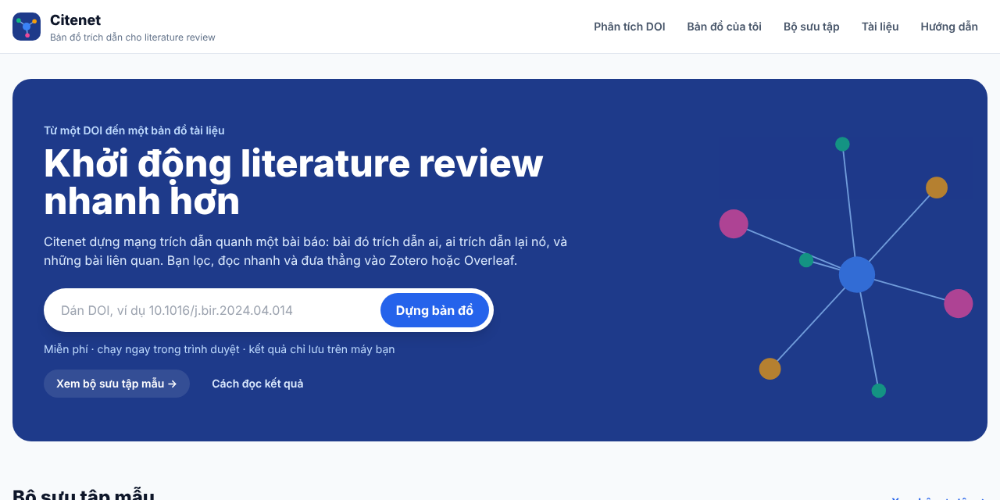
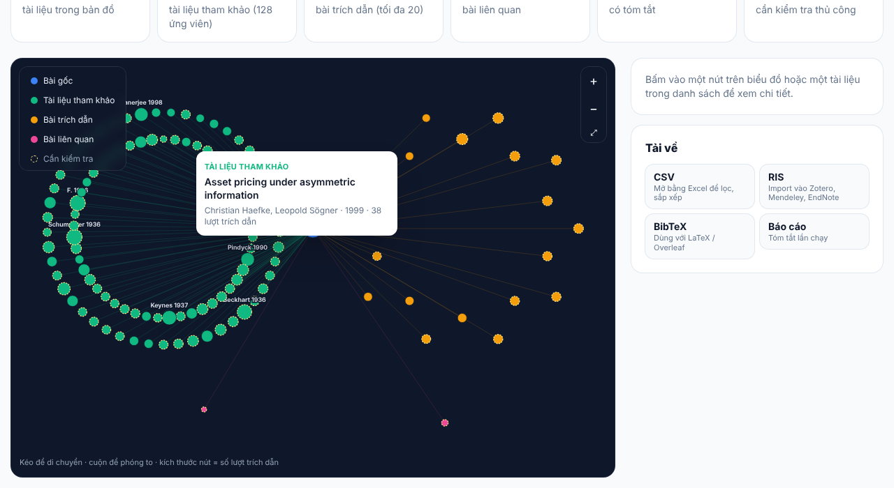
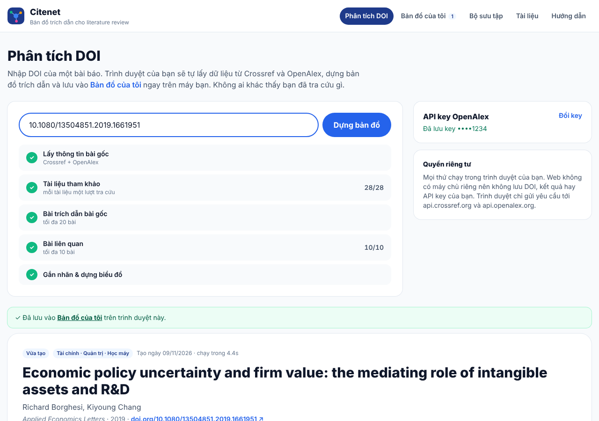
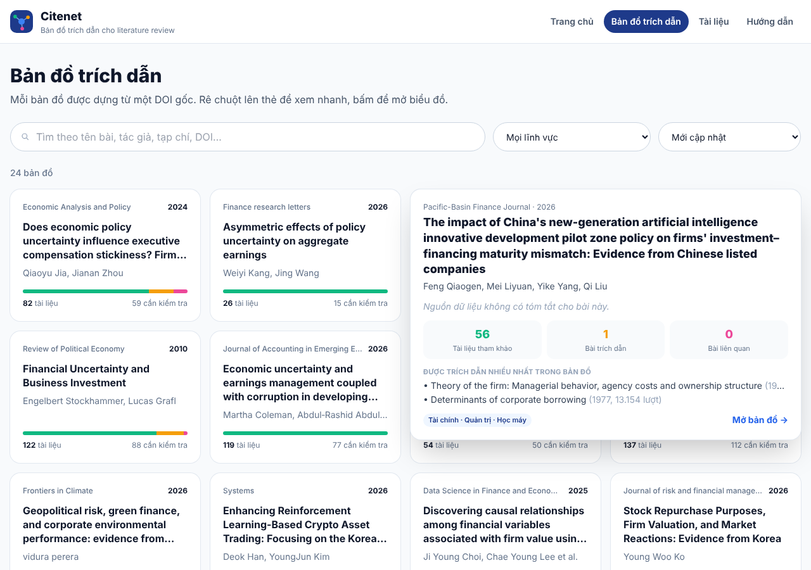
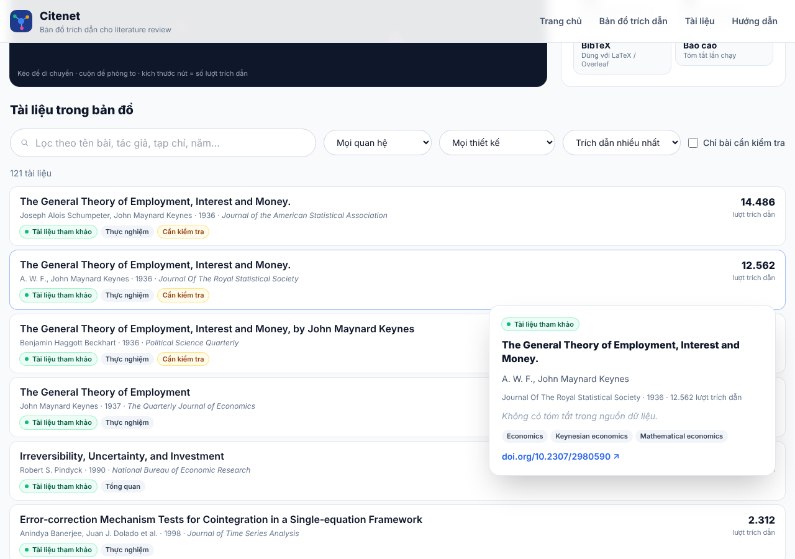

# Citenet Web: bản đồ trích dẫn cho literature review

Dán một DOI, trình duyệt sẽ dựng **bản đồ trích dẫn** quanh bài báo đó: bài đó trích dẫn ai (backward), ai trích dẫn lại nó (forward) và những bài liên quan. Bạn lọc, đọc nhanh, rồi xuất sang Zotero, Overleaf hoặc Excel.

🔗 **Dùng ngay:** https://xuandieu68.github.io/-citenet_web/



> Citenet dùng để **khởi động** literature review và khám phá tài liệu. Công cụ không thay thế systematic review, việc đọc toàn văn hay kiểm tra thủ công. Nhãn phân loại chỉ là gợi ý sắp xếp, không phải kết luận khoa học.

## Hai phần của web

| | **Công cụ** | **Bộ sưu tập mẫu** |
|---|---|---|
| Ai tạo | Người dùng, ngay trên web | Chủ dự án, chạy Citenet (Python) trên máy |
| Lưu ở đâu | `localStorage` của trình duyệt người dùng | `public/data` trong repo |
| Ai thấy | Chỉ người đã tạo | Mọi người |
| Trang | Phân tích DOI · Bản đồ của tôi | Bộ sưu tập · Tài liệu |

## Tính năng

| Trang | Địa chỉ | Nội dung |
|---|---|---|
| Trang chủ | `#/` | Ô dán DOI, bản đồ của tôi, bộ sưu tập mẫu, tài liệu được trích dẫn nhiều nhất |
| Phân tích DOI | `#/analyze?doi=…` | Dựng bản đồ ngay trong trình duyệt, có tiến trình từng bước, nút Hủy, cài đặt API key OpenAlex |
| Bản đồ của tôi | `#/mine`, `#/mine/<slug>` | Bản đồ đã tạo (chỉ trên máy này); chạy lại, xóa, sao lưu / nhập file `.json` |
| Bộ sưu tập | `#/maps`, `#/map/<slug>` | 5 bản đồ mẫu do chủ dự án chọn (`collection.json`) |
| Tài liệu | `#/papers` | Mọi tài liệu của bộ sưu tập, đã gộp trùng theo DOI |
| Hướng dẫn | `#/guide` | Cách đọc biểu đồ, các con số, API key, quyền riêng tư, giới hạn |

Mỗi bản đồ, dù là mẫu hay tự tạo, có:
- **Biểu đồ tương tác** giữ đúng bố cục và màu của Citenet: 🔵 bài gốc · 🟢 tài liệu tham khảo · 🟠 bài trích dẫn · 🩷 bài liên quan. Kéo để di chuyển, cuộn để phóng to, bấm chú thích để ẩn/hiện nhóm. Rê chuột vào nút để xem tooltip, bấm vào nút để mở bảng chi tiết.
- **Danh sách tài liệu** có bộ lọc (quan hệ, thiết kế nghiên cứu, cần kiểm tra, từ khóa). Bộ lọc cũng làm mờ các nút không khớp trên biểu đồ.
- **Tải về** CSV · RIS (Zotero/Mendeley/EndNote) · BibTeX (Overleaf) · báo cáo `summary.md`. Với bản đồ tự tạo, các file này được sinh ngay trong trình duyệt.
- **Thẻ xem nhanh khi rê chuột**: component `HoverPreview` dùng chung. Với thẻ trong lưới, thẻ xem nhanh đè lên và rộng gấp đôi. Với dòng trong danh sách, thẻ xem nhanh hiện bên dưới, không che dòng gốc.



| Phân tích DOI | Thẻ xem nhanh | Danh sách tài liệu |
|---|---|---|
|  |  |  |

## Citenet chạy trong trình duyệt như thế nào

`src/lib/citenet.js` là bản JavaScript của `citenet/main.py`, giữ nguyên từng bước:

1. Chuẩn hóa DOI, rồi gọi song song **Crossref** `/works/{doi}` và **OpenAlex** `/works/https://doi.org/{doi}`.
2. **Backward**: `referenced_works` của OpenAlex, gộp với DOI trong reference của Crossref, mỗi tài liệu tra một lần (5 luồng, tối đa khoảng 9 yêu cầu/giây).
3. **Forward**: `filter=cites:{id}`, 20 bài được trích dẫn nhiều nhất. **Related**: 10 bài `related_works` đầu tiên.
4. Gộp trùng, gắn nhãn bằng luật từ khóa (chủ đề, phương pháp, thiết kế, mức bằng chứng, độ tin cậy; dưới 0,74 thì đánh dấu "cần kiểm tra"), dựng bố cục, tạo cạnh và tóm tắt.

**Kiểm chứng:** `test/compare-with-python.mjs` chạy bản JS trên chính các phản hồi API mà bản Python đã lưu trong `work/Citenet/cache`, rồi so với `graph.json` của Python. Kết quả với 2 DOI (16 và 40 tài liệu): **0 khác biệt** ở mọi trường và mọi nhãn. Các file CSV, RIS và BibTeX giống hệt từng byte.

```bash
node test/compare-with-python.mjs <work/Citenet/cache> <outputs/Citenet/<slug>/graph.json> <DOI>
```

### API key OpenAlex

Từ tháng 2/2026, OpenAlex yêu cầu API key (miễn phí) để có hạn mức hằng ngày đủ dùng. Trên web, mỗi người dùng **tự dán key của mình**. Key được lưu trong `localStorage` và chỉ được gửi kèm các yêu cầu tới `api.openalex.org`. Repo không chứa key nào. Không có key, web vẫn chạy nhưng có thể báo hết hạn mức.

## Công nghệ

React 18 · Vite 5 · Tailwind CSS 3 · React Router 6 (`HashRouter`) · SVG thuần · `fetch` + `localStorage` · Python 3 (chuẩn bị bộ sưu tập) · GitHub Actions + GitHub Pages. Không có máy chủ riêng.

## Cấu trúc thư mục

```
├─ collection.json                  # ★ Chọn bản đồ nào được công khai trong Bộ sưu tập
├─ scripts/build_data.py            # ★ outputs/Citenet → public/data (chỉ các bản đồ trong collection.json)
├─ test/
│  ├─ compare-with-python.mjs       # So pipeline JS với graph.json của Python
│  └─ compare-exports.mjs           # So CSV/RIS/BibTeX với file của Python
├─ public/data/, public/downloads/  # Dữ liệu tĩnh của Bộ sưu tập (do script tạo)
├─ vite.config.js                   # ★ base: '/-citenet_web/' (trùng tên repo)
└─ src/
   ├─ lib/
   │  ├─ citenet.js                 # Pipeline Citenet bằng JavaScript
   │  ├─ webmap.js                  # graph.json → dữ liệu gọn cho giao diện
   │  ├─ exporters.js               # CSV, RIS, BibTeX, summary.md
   │  └─ storage.js                 # API key + Bản đồ của tôi (localStorage), sao lưu / nhập
   ├─ hooks/                        # useData (bộ sưu tập), useMine (bản đồ của tôi)
   ├─ components/
   │  ├─ MapView.jsx                # Giao diện một bản đồ (dùng chung mẫu + tự tạo)
   │  ├─ CitationGraph.jsx          # Biểu đồ SVG tương tác
   │  ├─ HoverPreview.jsx           # Thẻ xem nhanh dùng chung
   │  ├─ MapCard.jsx, PaperCard.jsx, PaperDetail.jsx, ApiKeyPanel.jsx, ui.jsx
   └─ pages/                        # Home, Analyze, MyMaps, MyMap, Maps, MapDetail, Papers, Guide
```

## Chạy trên máy

```bash
npm install
npm run dev        # http://localhost:5173/-citenet_web/
npm run build
```

## Cập nhật Bộ sưu tập (chủ dự án)

1. Chạy Citenet trên máy với DOI muốn giới thiệu: `.\run_citenet.ps1 "10.xxxx/yyyy"`.
2. Thêm tên thư mục kết quả (slug, ví dụ `10-1016-j-bir-2024-04-014`) vào `maps` trong `collection.json`.
3. `python scripts/build_data.py "<đường dẫn outputs/Citenet>"`. Script chỉ đưa lên web các bản đồ có trong danh sách, xóa dữ liệu cũ, và **không ghi đường dẫn máy tính** vào dữ liệu.
4. Commit và push. Web cập nhật sau khoảng 30 giây.

Các kết quả Citenet không có trong `collection.json` vẫn nằm riêng trên máy bạn.

## Giới hạn

- Kết quả phụ thuộc độ bao phủ và thời điểm cập nhật của Crossref/OpenAlex. Số lượt trích dẫn không phải con số chính thức duy nhất.
- Không tải PDF, không đọc toàn văn. Nhãn được suy ra từ tiêu đề và tóm tắt bằng luật từ khóa.
- Bản đồ chỉ mở rộng một tầng quanh bài gốc.
- Bản đồ tự tạo nằm trong `localStorage` (khoảng 5 MB, đủ cho vài chục bản đồ), nên hãy sao lưu nếu cần giữ lâu dài.
- Tóm tắt hiển thị là bản OpenAlex cung cấp, bản quyền thuộc tác giả/nhà xuất bản. Hãy xác minh tài liệu quan trọng qua trang nhà xuất bản, DOI và Zotero/Scite trước khi trích dẫn.

## Hướng phát triển

- [ ] So sánh hai bản đồ, tô sáng tài liệu chung
- [ ] Xuất danh sách đã lọc
- [ ] Đánh dấu đã đọc / muốn đọc
- [ ] Mở rộng thêm một tầng (tài liệu tham khảo của tài liệu tham khảo)

## Ghi công

Citenet (pipeline Python) và quy trình literature review: dự án của người dùng. Web và bản JavaScript được xây dựng với sự hỗ trợ của Claude (Anthropic). Metadata từ Crossref và OpenAlex (OpenAlex phát hành theo CC0).
